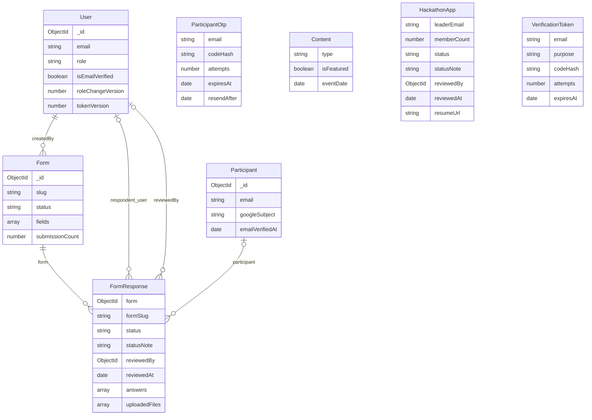

# Veritabanı Mimarisi (11 Kasım 2026 — Güncel Sürüm)

User rol listesinde `PENDING`, `MEMBER`, `ORGANIZER`, `ADMIN` tanımlıdır; eşzamanlı admin işlemleri için `roleChangeVersion`, JWT iptali için `tokenVersion` kullanılır. `VerificationToken`, `node:crypto` `randomInt` ve HMAC-SHA256 (`codeHash`) kullanır; `PASSWORD_RESET` amacını destekler ve `{ email: 1, purpose: 1 }` partial unique index ile korunur. `FormResponse` ve `HackathonApp` modellerinde başvuru inceleme alanları (`status`, `statusNote`, `reviewedBy`, `reviewedAt`, `lastNotifiedStatus`, `lastNotifiedAt`) ve durum filtreleme indeksleri yer alır. `FormResponse` üzerinde `(form, singleSubmissionKey)` partial unique index mükerrer gönderimleri engeller. `EventPage` modeli güncel etkinlik JSON'u, `formSlug`, `revision` ve `updatedBy` saklar.

[← Mevcut proje durumu](MEVCUT_PROJE_DURUMU.md)

> Güncelleme: 11 Kasım 2026 — `iyilestirme-ve-test` çalışma dalı (Commit: `b4fbf69`). Başvuru durum alanları, şifre sıfırlama token'ları ve güvenli indeksler dahil.

Varsayılan veritabanı `gdg_pau`; toplam dokuz model (`User`, `Form`, `FormResponse`, `EventPage`, `Content`, `HackathonApp`, `VerificationToken`, `Participant`, `ParticipantOtp`) vardır (eski `Team` modeli kaldırıldı; koleksiyondaki eski veriler silinmez). Form submit transaction’ları için replica set veya Atlas gerekir; sunucu açılışı standalone bağlantıyı reddeder. Mongoose modellerinde `versionKey:false`; `__v` sürüm alanı tutulmuyor. Her dokümanda MongoDB `_id` kimliği bulunur.

Diyagramdaki bağlantılar Mongoose referanslarıdır; SQL foreign key gibi DB tarafından zorunlu ilişki bütünlüğü sağlamaz. VerificationToken e-posta metniyle çalışır; User'a ObjectId referansı yoktur. Content ve HackathonApp bağımsızdır.

### User → `users`

| Alan | Tip | Kural / varsayılan |
| --- | --- | --- |
| `fullName` | String | Zorunlu, trim, 2–100 karakter |
| `email` | String | Zorunlu, unique, lowercase/trim, üç izinli domain (`gmail.com`, `pau.edu.tr`, `posta.pau.edu.tr`) |
| `passwordHash` | String | Zorunlu; register/seed bcrypt 10 salt round kullanır |
| `role` | String enum | `PENDING/MEMBER/ORGANIZER/ADMIN`; default PENDING |
| `isEmailVerified` | Boolean | false |
| `roleChangeVersion` | Number | default 0; eşzamanlı admin rol değişimlerini sıraya koyar |
| `tokenVersion` | Number | default 0; şifre sıfırlama veya rol değişiminde artırılarak eski JWT'leri anında geçersiz kılar |
| `createdAt` | Date | Şimdiki zaman |

`toJSON()` passwordHash'ı çıkarır; auth controller'ları seçici projection ile yanıt verir. Şifre bcrypt ile hash edilir. Eski `permissions` alanı şemadan kaldırıldı (eski belgelerde kalsa da okunmaz); yetkilendirme doğrudan `role` alanı üzerinden yürütülür.

### Content → `contents`

`title,description,type` zorunlu; `coverImageUrl,bevyLink,eventDate` null; `isFeatured` false; `createdAt` şimdi. Content silindiğinde veya güncellendiğinde eski yerel kapak görseli (`/uploads/public/...`) diskten güvenli şekilde silinir (`unlink`). EVENT/ANNOUNCEMENT ortak koleksiyonda tutulur.

### Form → `forms`

`title`, unique `slug`, `status`, `category`, banner, tarih sınırları, `maxSubmissions`, `submissionCount`, gömülü `fields/settings`, `createdBy:User` referansı. `createdAt` ve `updatedAt` timestamps ile tutulur.

`settings` içinde `verificationRequired` (true), `verificationMethods` (GOOGLE/EMAIL_OTP), `allowMultipleSubmissions` (true), eski `requireAuth` (false) ve başarı mesajı tutulur. `maxSubmissions` için min 1 doğrulaması vardır; controller 0/boş değeri null’a dönüştürerek kotayı kapatır. Sayaç rezervasyonu `updatedAt` değerini değiştirmez; bu alan şema/ayar düzenlemesinin kontrolü için kullanılır.

Sorular form dokümanında gömülüdür (`fields[]`). Her sorunun kalıcı anahtarı `fieldId` değeridir. Backend `Form` şemasında 10 alan türü desteklenir (`text`, `textarea`, `number`, `email`, `phone`, `select`, `radio`, `checkbox`, `file`, `date`; etkinlik şemasındaki `tel` türü `eventPageService` tarafından `phone` türüne eşlenir).

### FormResponse → `formresponses`

| Alan | Yapı |
| --- | --- |
| `form` | Zorunlu ObjectId → Form |
| `participant` | Opsiyonel ObjectId → Participant; doğrulanmış katılımcı |
| `verifiedEmail` | Backend’in katılımcıdan aldığı e-posta |
| `verificationMethod` | GOOGLE / EMAIL_OTP / null |
| `verifiedAt` | Token’ın üretildiği doğrulama zamanı; Date veya null |
| `singleSubmissionKey` | Yalnız tek başvurulu yanıtlarda katılımcı ID’sinin metni |
| `formSlug` | Zorunlu String; başvuru anındaki slug kopyası |
| `answers[]` | `{fieldId, label, value}`; value `Mixed`, null varsayılan |
| `schemaVersion` | Date veya null; başvuru anındaki form sürümü (`Form.updatedAt`) |
| `uploadedFiles[]` | `{fieldId,originalName,filename,url,size}` |
| `respondent` | `{ip,userAgent,user}`; user opsiyonel User referansı |
| `submittedAt` | Date, varsayılan `Date.now`, indeksli |
| `status` | String enum `['PENDING', 'APPROVED', 'REJECTED']`, varsayılan `'PENDING'`, indeksli |
| `statusNote` | String, trim, en fazla 1000 karakter, varsayılan `''` |
| `reviewedBy` | Opsiyonel ObjectId → User; inceleyen yönetici/organizatör |
| `reviewedAt` | Date, inceleme zamanı veya null |
| `lastNotifiedStatus` | String enum `['APPROVED', 'REJECTED', null]`, son e-posta bildirimi durumu |
| `lastNotifiedAt` | Date, son e-posta bildiriminin başarıyla gönderildiği tarih veya null |

Cevaplar formdan ayrı koleksiyonda tutulur. İndeksler: `{ form: 1, submittedAt: -1 }`, `{ form: 1, status: 1, submittedAt: -1 }` ve `{ form: 1, singleSubmissionKey: 1 }` (partial unique). Bu partial unique indeks, tek başvurulu formlarda mükerrer gönderimleri veritabanı düzeyinde engeller.

### HackathonApp → `hackathonapps`

Takım ve lider bilgileri (`teamName`, `leaderName`, `leaderEmail`, `leaderPhone`, `memberCount`, `projectIdea`, `resumeUrl`, `appliedAt`).

11 Kasım 2026 güncellemesiyle modele başvuru durum inceleme alanları eklenmiştir:
- `status`: String enum `['PENDING', 'APPROVED', 'REJECTED']`, varsayılan `'PENDING'`, indeksli.
- `statusNote`: String, trim, en fazla 1000 karakter, varsayılan `''`.
- `reviewedBy`: Opsiyonel ObjectId → User referansı.
- `reviewedAt`: Date veya null.
- `lastNotifiedStatus`: String enum `['APPROVED', 'REJECTED', null]`.
- `lastNotifiedAt`: Date veya null.

İndeksler: tekil `appliedAt` (`index: true`, varsayılan `1`) ve tekil `status` (`index: true`). (`$text` indeksi tanımlı değildir; metin araması controller katmanında `literalSearch` regex'i üzerinden `teamName`, `leaderName`, `leaderEmail` alanlarında yapılır.)

### VerificationToken → `verificationtokens`

E-posta, `codeHash` (HMAC-SHA256), amaç (`purpose`), `attempts`, `expiresAt`, `resendAfter`, `createdAt`. Amaçlar `REGISTER`, `PASSWORD_RESET`, `HACKATHON_APPLY`, `LOGIN_2FA` (ayrılmış/legacy).

`VerificationToken.generateOtp`, `node:crypto` kütüphanesinin `randomInt(100000, 1000000)` fonksiyonunu kullanarak kriptografik olarak güvenli 6 haneli rastgele kod üretir. Kod açık metin olarak saklanmaz; backend sırrı (`TEAM_AUTH_SECRET` veya `JWT_SECRET`) ile HMAC-SHA256 hash'lenerek `codeHash` alanına kaydedilir. 10 dakika geçerlidir ve 60 saniyelik yeniden gönderme bekleme süresi (`resendAfter`) uygular.

İndeksler: `expiresAt` TTL (`expireAfterSeconds: 0`), `{ email: 1, purpose: 1 }` partial unique index (`codeHash: { $type: 'string' }`). Bu sayede eşzamanlı isteklerde mükerrer token oluşması `E11000` ile engellenir.

### Participant → `participants`

Ekip kullanıcısından bağımsız kimlik. Alanlar: unique/lowercase/trim `email`, en fazla 100 karakter `fullName` (varsayılan boş), opsiyonel `googleSubject`, zorunlu `emailVerifiedAt`, timestamps `createdAt/updatedAt`. `googleSubject` unique sparse indeksle korunur. E-posta OTP’si aynı e-postanın katılımcısını oluşturur/günceller; Google yalnızca doğrulanmış kimlikten hesap ilişkilendirir. Parola veya ekip rolü yoktur.

### ParticipantOtp → `participantotps`

Unique `email`, HMAC-SHA256 `codeHash`, `attempts`, `expiresAt`, `resendAfter`, `createdAt`. Ayrı bir katılımcı OTP havuzudur; eski VerificationToken modelinin FORM_SUBMIT enum’unu kullanmaz. Kod `crypto.randomInt` ile üretilir, katılımcı imza anahtarıyla hash’lenir. Doğru kod süre/deneme şartlarıyla `findOneAndDelete` üzerinden atomik tüketilir. Süre ve deneme sınırı env’den alınır. TTL temizliği anlık değildir; kod ayrıca süreyi denetler.

### Kodda tanımlı indeksler

Her koleksiyonda MongoDB'nin `_id` indeksi beklenir; ek tanımlar:

| Model | İndeksler |
| --- | --- |
| User | `email` unique |
| Content | Tekil `isFeatured`, `type`, `createdAt`; bileşik `{type:1,createdAt:-1}`, `{isFeatured:1,createdAt:-1}` |
| Form | `slug` unique; tekil `status`, `category`; bileşik `{status:1,createdAt:-1}`, `{category:1,status:1}` |
| FormResponse | Tekil `form`, `formSlug`, `submittedAt`, `status`; bileşik `{form:1,submittedAt:-1}`, `{form:1,status:1,submittedAt:-1}`; `{form:1,singleSubmissionKey:1}` partial unique (anahtar String ise) |
| HackathonApp | Tekil `appliedAt` (`1`) ve tekil `status` (`1`) |
| Participant | `email` unique; `googleSubject` unique sparse |
| ParticipantOtp | `email` unique; `expiresAt` TTL (`expireAfterSeconds:0`) |
| VerificationToken | Tekil `email`, `purpose`; `expiresAt` TTL (`expireAfterSeconds:0`); `{email:1,purpose:1}` partial unique (`codeHash` String ise) |

Hackathon araması controller katmanında `teamName`, `leaderName` ve `leaderEmail` alanları üzerinde kaçışlı `literalSearch` regex aramalarını destekler (`$text` indeksi tanımlı değildir). Token için `{ email: 1, purpose: 1 }` partial unique indeksi tanımlıdır; eşzamanlı kod üretiminde birden fazla token oluşması veritabanı seviyesinde `E11000` ile engellenir ve 60 saniyelik bekleme süresi kuralı (`resendAfter`) atomik olarak işletilir.

### Bütünlük ve eşzamanlılık

- Submit, Form kaydını transaction içinde önce yazar; kota rezervasyonu, tekrar başvuru kontrolü ve FormResponse oluşturma aynı transaction’dadır. Çakışan işlemler MongoDB/Mongoose transaction yeniden denemeleriyle işlenir. Başarısız işlem sayaç artışını geri alır.
- Aynı katılımcının aynı tek başvurulu forma eşzamanlı gönderiminde yalnız bir kayıt oluştuğu test edildi. Partial unique indeks ek DB korumasıdır.
- Form `updatedAt` değeri upload sırasında değişirse submit 409 verir.
- Katılımcı OTP tüketimi atomiktir (`findOneAndDelete`). Ekip şifre sıfırlama OTP'si `verifyOtp` ile doğrulanıp atomik olarak silinir.
- Rol güncellemeleri transaction içinde aktörün `roleChangeVersion` değerini artırarak eşzamanlı admin kaybını engeller.
- Dosya sistemi ile DB arasında transaction yoktur. Submit controller’ının reddettiği dosyalar `unlink` ile silinir.
- Başlangıçta Participant, ParticipantOtp ve FormResponse indekslerinin init işlemi beklenir. Canlı ortamın tüm indeksleri ve performansı ayrıca incelenmelidir.
