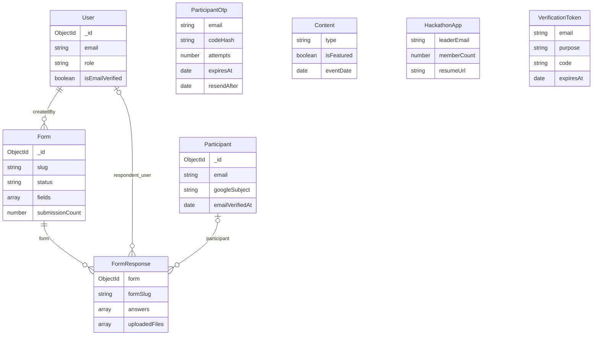

# Veritabanı mimarisi

[← Mevcut proje durumu](MEVCUT_PROJE_DURUMU.md)

> Güncelleme: 12 Ekim 2026 — `feature/participant-verification` çalışma ağacı. Katılımcı doğrulaması ve testler dahil.

Varsayılan veritabanı `gdg_pau`; toplam sekiz model vardır. Form submit transaction’ları için replica set veya Atlas gerekir; sunucu açılışı standalone bağlantıyı reddeder. Mongoose modellerinin varsayılan koleksiyon adları aşağıdadır; bunlar koddan beklenen adlardır, canlı DB'de incelenmedi. Bütün modellerde `versionKey:false`; `__v` sürüm alanı tutulmuyor. Her dokümanda MongoDB `_id` kimliği bulunur.

Diyagramdaki bağlantılar Mongoose referanslarıdır; SQL foreign key gibi DB tarafından zorunlu ilişki bütünlüğü sağlamaz. VerificationToken e-posta metniyle çalışır; User'a ObjectId referansı yoktur. Content ve HackathonApp bağımsızdır.

### User → `users`

| Alan | Tip | Kural / varsayılan |
| --- | --- | --- |
| `fullName` | String | Zorunlu, trim, 2–100 karakter |
| `email` | String | Zorunlu, unique, lowercase/trim, üç izinli domain |
| `passwordHash` | String | Zorunlu; register/seed bcrypt 10 salt round kullanır |
| `role` | String enum | `PENDING/ORGANIZER/ADMIN`; default PENDING |
| `isEmailVerified` | Boolean | false |
| `createdAt` | Date | Şimdiki zaman |

`toJSON()` passwordHash'ı çıkarır; her tür sorgu dönüşünün otomatik güvenli olduğu varsayılmamalı. Auth controller'ları alan seçerek yanıt verir. Şifre model hook'unda değil register/seed içinde hash edilir. Doğrudan DB/model yazan gelecekteki kod aynı kuralı korumalı.

### Content → `contents`

`title,description,type` zorunlu; `coverImageUrl,bevyLink,eventDate` null; `isFeatured` false; `createdAt` şimdi. Content'in `createdBy`, `updatedAt`, yayın durumu veya ayrı slug alanı yok. EVENT/ANNOUNCEMENT ortak koleksiyonda tutulur; etkinliklere özel kapasite veya katılımcı ilişkisi bulunmaz.

### Form → `forms`

`title`, unique `slug`, `status`, `category`, banner, tarih sınırları, `maxSubmissions`, `submissionCount`, gömülü `fields/settings`, `createdBy:User` referansı. `createdAt` ve `updatedAt` timestamps ile tutulur.

`settings` içinde `verificationRequired` (true), `verificationMethods` (GOOGLE/EMAIL_OTP), `allowMultipleSubmissions` (true), eski `requireAuth` (false) ve başarı mesajı tutulur. `maxSubmissions` için min 1 doğrulaması vardır; controller 0/boş değeri null’a dönüştürerek kotayı kapatır. Sayaç rezervasyonu `updatedAt` değerini değiştirmez; bu alan şema/ayar düzenlemesinin kontrolü için kullanılır.

Sorular ayrı koleksiyonda değil aynı form dokümanında gömülüdür. Her sorunun `_id` alanı yok; kimlik `fieldId`. Bu yapı tek sorguda formu getirmek için uygundur. Ancak aynı formu düzenleyince eski yanıtlar için soru şeması sürümü saklanmaz.

### FormResponse → `formresponses`

| Alan | Yapı |
| --- | --- |
| `form` | Zorunlu ObjectId → Form |
| `participant` | Opsiyonel ObjectId → Participant; doğrulanmış katılımcı |
| `verifiedEmail` | Backend’in katılımcıdan aldığı e-posta |
| `verificationMethod` | GOOGLE / EMAIL_OTP / null |
| `verifiedAt` | Token’ın üretildiği doğrulama zamanı; Date veya null |
| `singleSubmissionKey` | Yalnız tek başvurulu yanıtlarda katılımcı ID’sinin metni |
| `formSlug` | Zorunlu String; başvuru anındaki slug kopyası |
| `answers[]` | `{fieldId, label, value}`; value `Mixed`, null varsayılan |
| `uploadedFiles[]` | `{fieldId,originalName,filename,url,size}` |
| `respondent` | `{ip,userAgent,user}`; user opsiyonel User referansı |
| `submittedAt` | Date, şimdi |

Cevaplar formdan ayrı koleksiyonda tutulduğu için form büyüklüğü cevap sayısıyla artmaz. `label` kopyası soru metninin gönderim anını kısmen korur; fakat export güncel `Form.fields` şemasını kullanır. `Mixed` esneklik sağlar, tip güvenliği için controller doğrulaması gerekir. IP ve user agent veri olarak saklanır.

### HackathonApp → `hackathonapps`

Takım/lider bilgileri, üye sayısı, proje fikri, isteğe bağlı CV URL'si ve `appliedAt`. Takım üyelerinin bireysel bilgileri yok; yalnızca sayı tutulur. Başvurunun onay/red durumu, etkinlik ID'si, yıl veya hakem değerlendirmesi yok. Takım adı/e-posta unique değil; birden çok kodla tekrar başvuru mümkündür.

### VerificationToken → `verificationtokens`

E-posta, düz metin kod, amaç, attempts, expiresAt, createdAt. Amaçlar `REGISTER`, `LOGIN_2FA`, `HACKATHON_APPLY`, `FORM_SUBMIT`; mevcut controller'lar yalnızca REGISTER ve HACKATHON_APPLY kullanır.

`expiresAt` TTL indeksi kaydı süre dolunca otomatik temizlemek üzere tanımlanmış. Kod ayrıca süreyi kontrol eder; TTL temizliği tam süre sonunda gerçekleşecek diye varsayılmaz. Kod üretimindeki `Math.random()` kriptografik rastgelelik sağlamaz; kaynak yorumundaki güvenlik iddiasıyla uyumlu değildir.

### Participant → `participants`

Ekip kullanıcısından bağımsız kimlik. Alanlar: unique/lowercase/trim `email`, en fazla 100 karakter `fullName` (varsayılan boş), opsiyonel `googleSubject`, zorunlu `emailVerifiedAt`, timestamps `createdAt/updatedAt`. `googleSubject` unique sparse indeksle korunur. E-posta OTP’si aynı e-postanın katılımcısını oluşturur/günceller; Google yalnızca doğrulanmış kimlikten hesap ilişkilendirir. Parola veya ekip rolü yoktur.

### ParticipantOtp → `participantotps`

Unique `email`, HMAC-SHA256 `codeHash`, `attempts`, `expiresAt`, `resendAfter`, `createdAt`. Ayrı bir katılımcı OTP havuzudur; eski VerificationToken modelinin FORM_SUBMIT enum’unu kullanmaz. Kod `crypto.randomInt` ile üretilir, katılımcı imza anahtarıyla hash’lenir. Doğru kod süre/deneme şartlarıyla `findOneAndDelete` üzerinden atomik tüketilir. Süre ve deneme sınırı env’den alınır. TTL temizliği anlık değildir; kod ayrıca süreyi denetler.

### Kodda tanımlı indeksler

Her koleksiyonda MongoDB'nin `_id` indeksi beklenir; ek tanımlar:

| Model | İndeksler |
| --- | --- |
| User | `email` unique |
| Content | Tekil `isFeatured`, `type`, `createdAt`; bileşik `{type:1,createdAt:-1}`, `{isFeatured:1,createdAt:-1}` |
| Form | `slug` unique; tekil `status`, `category`; bileşik `{status:1,createdAt:-1}`, `{category:1,status:1}` |
| FormResponse | Tekil `form`, `formSlug`, `submittedAt`; bileşik `{form:1,submittedAt:-1}`; `{form:1,singleSubmissionKey:1}` partial unique (anahtar String ise) |
| HackathonApp | `appliedAt` için alan üzerinde ve ayrıca `{appliedAt:-1}`; `{teamName:'text',leaderName:'text',leaderEmail:'text'}` |
| Participant | `email` unique; `googleSubject` unique sparse |
| ParticipantOtp | `email` unique; `expiresAt` TTL (`expireAfterSeconds:0`) |
| VerificationToken | Tekil `email`, `purpose`; `expiresAt` TTL (`expireAfterSeconds:0`) |

Hackathon araması `$text` kullanmadığı için text indeksi bu aramayı doğrudan karşılamaz. Sınırsız, başlangıca sabitlenmemiş regex aramalarının maliyeti veri büyüdükçe artabilir. Featured sıralamasındaki `eventDate` mevcut bileşik indekste yok. Token için sık kullanılan `(email,purpose)` sorgusu bileşik unique indeksle korunmuyor; eşzamanlı kod üretiminde birden fazla token riski var. İndekslerin fiilen oluştuğu ve performansı `getIndexes()/explain` ile ayrıca ölçülmeli.

### Bütünlük ve eşzamanlılık

- Submit, Form kaydını transaction içinde önce yazar; kota rezervasyonu, tekrar başvuru kontrolü ve FormResponse oluşturma aynı transaction’dadır. Çakışan işlemler MongoDB/Mongoose transaction yeniden denemeleriyle işlenir. Başarısız işlem sayaç artışını geri alır.
- Aynı katılımcının aynı tek başvurulu forma eşzamanlı gönderiminde yalnız bir kayıt oluştuğu test edildi. Partial unique indeks ek DB korumasıdır; önceki çoklu cevaplar ve eski anonim cevaplar dönüştürülmez.
- Form `updatedAt` değeri upload sırasında değişirse submit 409 verir. Bu kontrol tam şema sürümleme/snapshot değildir; eski cevapları export ederken hâlâ güncel sorular kullanılır.
- Katılımcı OTP tüketimi atomiktir. Ekip/hackathon VerificationToken tüketimi eski okuma/silme davranışındadır; aynı güvenceye sahip değildir.
- Form ve yanıtların silinmesi hâlâ transaction kullanmaz.
- Dosya sistemi ile DB arasında transaction yok. Submit controller’ının reddettiği dosyalar silinmeye çalışılır; süreç çökmesi veya disk hatasında yetim dosya riski sürer.
- Slug kontrolü yarışabilir; unique indeks çakışmada son korumadır.
- Başlangıçta Participant, ParticipantOtp ve FormResponse indekslerinin init işlemi beklenir. Canlı ortamın tüm indeksleri ve performansı ayrıca incelenmelidir.
