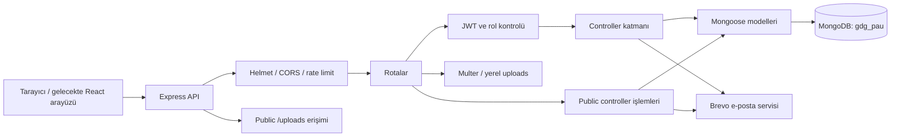

# Uygulama mimarisi

[← Mevcut proje durumu](MEVCUT_PROJE_DURUMU.md)

> Kaynak kod incelemesi: 11 Ekim 2026, sürüm `d218156`. Canlı API ve veritabanı testi yapılmadı. Belgelerin ayrılması: 12 Ekim 2026.

Backend tek Express süreci ve tek MongoDB bağlantısı kullanan katmanlı bir monolittir. Hackathon ayrı klasörde modülerleştirilmiştir; ayrı servis veya ayrı veritabanı değildir.

### Klasörlerin sorumlulukları

| Yol | Sorumluluk |
| --- | --- |
| `frontend/src/App.jsx` | Şu an Vite/React örnek ekranı; API çağrısı yok |
| `backend/src/server.js` | `.env` yükleme, DB bağlantısı, sunucuyu başlatma, kapanış sinyalleri |
| `backend/src/app.js` | HTTP middleware, statik dosyalar, route mount, sağlık ve hata yanıtları |
| `backend/src/config/db.js` | Mongoose bağlantısı |
| `backend/src/routes/` | HTTP metodu, yol, auth/rol/upload middleware bağlama |
| `backend/src/controllers/` | Auth, içerik ve form iş kuralları ile sorgular |
| `backend/src/models/` | Veri şemaları ve bazı model metotları |
| `backend/src/modules/hackathon/` | Hackathon route/controller/model ve açma-kapama koşulu |
| `backend/src/services/emailService.js` | Brevo REST çağrısı ve OTP e-posta şablonları |
| `backend/src/utils/` | JWT, girdi doğrulayıcıları ve seed |
| `backend/uploads/` | Dosyaların yerel diskte tutulduğu alan |

Hackathon için eski `controllers/hackathonController.js`, `routes/hackathonRoutes.js`, `models/HackathonApp.js` dosyaları yeni modüle yönlendiren proxy dosyalardır. İkinci bir uygulama veya ikinci koleksiyon oluşturmazlar.

Controller'lar hem HTTP yanıtlarını hem iş kurallarını hem DB işlemlerini yürütüyor. Form büyüdükçe doğrulama, başvuru kaydı ve dışa aktarmayı ayrı servislerde toplamak bakımı kolaylaştıracaktır.

### Teknolojiler

Backend: Node.js, CommonJS, Express 5, Mongoose 9, MongoDB, bcryptjs, jsonwebtoken, multer, cors, helmet, morgan ve express-rate-limit. Frontend: React 19, Vite 8, ES modules ve ESLint. Sürümler `package.json` bağımlılık aralıklarına dayanır; kurulu paketler doğrulanmadı. Backend lockfile var, frontend lockfile yok. Projede `engines` ile Node sürümü sabitlenmemiş; eski README'deki “Node 18+” ifadesi tüm mevcut bağımlılıkların uyumluluğunun kanıtı değildir.
