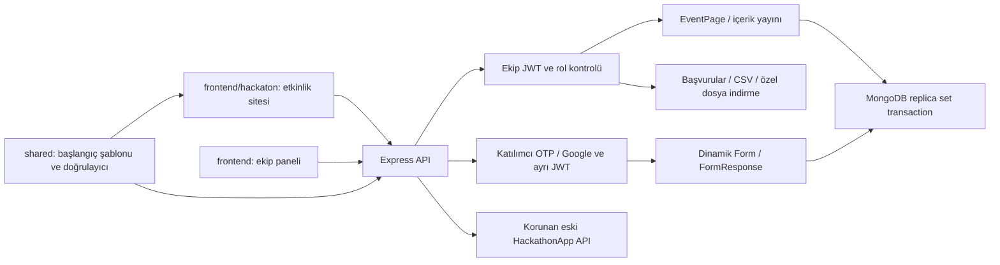

# Uygulama mimarisi

21 Ekim 2026. Tek Express API ve MongoDB bağlantısı kullanılır; hackathon bağımsız servis değildir.

| Sınır | Davranış |
| --- | --- |
| Ekip User | PENDING, MEMBER, ORGANIZER, ADMIN; admin onayı ve listeleme sunucuda korunur |
| Participant | Parolasız e-posta/Google doğrulaması; ayrı token audience/issuer/type; ekip yönetimine giriş vermez |
| Yeni başvuru | `hackathon-katilim` dinamik formu; tek katılımcı/tek başvuru, transaction ile kota ve sayaç |
| Eski başvuru | HackathonApp koleksiyonu; panelde kaynak seçimi; otomatik veri taşıma yok |
| Etkinlik içeriği | EventPage kalıcı kaynak; ilk örnek `shared/hackathon-event.json`; revision kontrolü ile form şemasıyla birlikte yayın |
| Dosya | Public görseller ve özel başvuru ekleri ayrı; özel indirme staff token'ı ister |
| Test | Node test runner + Supertest + geçici replica set; UI Vitest/Testing Library; E2E Playwright |

`frontend/hackaton` fiziksel olarak frontend altında bulunan ayrı Vite uygulamasıdır. Bu taşıma otomatik bir `/hackaton` URL alt yolu oluşturmaz. Geliştirmede iki ayrı origin kullanılır; production aynı origin veya ayrı origin ile açıkça yapılandırılabilir.

Kök komutları ve CI üç paketi birlikte kontrol eder. Manuel HTML/HTTP araçları geliştirici içindir; ürün akışları gerçek ön yüzlerde bulunur. Ek ayrıntılar [backend README](../backend/README.md) ve [mevcut durum](MEVCUT_PROJE_DURUMU.md) belgesindedir.
