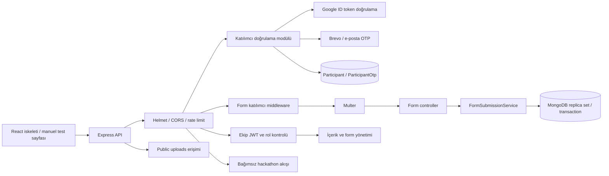

# Uygulama mimarisi

[← Mevcut proje durumu](MEVCUT_PROJE_DURUMU.md)

> Güncelleme: 12 Ekim 2026 — `feature/participant-verification` çalışma ağacı. Katılımcı doğrulaması ve testler dahil.

Backend tek Express süreci ve tek MongoDB bağlantısı kullanan katmanlı bir monolittir. Hackathon ayrı klasörde modülerleştirilmiştir; ayrı servis veya ayrı veritabanı değildir.

### Klasörlerin sorumlulukları

| Yol | Sorumluluk |
| --- | --- |
| `frontend/src/App.jsx` | Şu an Vite/React örnek ekranı; API çağrısı yok |
| `backend/src/server.js` | `.env`, katılımcı config kontrolü, DB topology/replica set kontrolü, yeni indeksleri bekleme, HTTP başlatma/kapanış |
| `backend/src/app.js` | HTTP middleware, statik dosyalar, route mount, sağlık ve hata yanıtları |
| `backend/src/config/db.js` | Mongoose bağlantısı |
| `backend/src/routes/` | HTTP metodu, yol, auth/rol/upload middleware bağlama |
| `backend/src/controllers/` | Auth, içerik ve form iş kuralları ile sorgular |
| `backend/src/models/` | Veri şemaları ve bazı model metotları |
| `backend/src/modules/participantAuth/` | Katılımcı config, modeller, OTP/Google/token servisleri, controller/router ve form kimlik middleware’i |
| `backend/src/services/formSubmissionService.js` | Transaction içinde kota, tek başvuru ve yanıt kaydı |
| `backend/tests/` | İzole MongoDB ve Google doğrulama otomatik testleri |
| `backend/tools/` | Elle çalıştırılan HTML ve HTTP test araçları; Express tarafından sunulmaz |
| `backend/src/modules/hackathon/` | Hackathon route/controller/model ve açma-kapama koşulu |
| `backend/src/services/emailService.js` | Brevo REST çağrısı ve OTP e-posta şablonları |
| `backend/src/utils/` | JWT, girdi doğrulayıcıları ve seed |
| `backend/uploads/` | Dosyaların yerel diskte tutulduğu alan |

Hackathon için eski `controllers/hackathonController.js`, `routes/hackathonRoutes.js`, `models/HackathonApp.js` dosyaları yeni modüle yönlendiren proxy dosyalardır. İkinci bir uygulama veya ikinci koleksiyon oluşturmazlar.

Katılımcı modülünde HTTP controller’ı OTP, Google doğrulama ve token servislerine delegasyon yapar. Form route’unda katılımcı middleware’i dosya yazılmadan önce kimliği denetler. Controller soru cevaplarını doğrular; kayıt ve kota işini FormSubmissionService yürütür. Mevcut içerik/ekip controller’ları ve form export/alan doğrulaması hâlâ daha fazla sorumluluk taşır.

### Kimlik ve modül sınırları

Ekip User hesabı ADMIN/ORGANIZER/PENDING rol sistemine bağlıdır. Participant hesabı etkinlik katılımı içindir; ekip onayı veya parola istemez. Katılımcı JWT’sinde ayrı audience, issuer ve type vardır; ekip middleware’i bu token’ı reddeder. `JWT_EXPIRES_IN` ekip, `PARTICIPANT_JWT_EXPIRES_IN` katılımcı süresidir. Ayrı imza anahtarı yapılandırılabilir.

Dinamik hackathon formu bu katılımcı doğrulamasını kullanır; özel hackathon modülü eski lider OTP’sini ve HackathonApp koleksiyonunu kullanır. Modülü kapatmak dinamik formu kapatmaz. Form ile Content arasında doğrudan etkinlik ilişkisi henüz yoktur.

Manuel test sayfası ürün frontend’i değildir. CORS tek CLIENT_URL origin’iyle çalışır; birden fazla origin desteği henüz eklenmedi.

### Teknolojiler

Backend: Node.js, CommonJS, Express 5, Mongoose 9, MongoDB, bcryptjs, jsonwebtoken, multer, cors, helmet, morgan ve express-rate-limit; Google için google-auth-library. Testlerde Node test runner, Supertest ve mongodb-memory-server kullanılır. Frontend: React 19, Vite 8, ES modules ve ESLint. Sürümler `package.json` bağımlılık aralıklarına dayanır; backend bağımlılıkları kuruldu ve testler çalıştırıldı; frontend kurulumu/build’i bu özellik kapsamında doğrulanmadı. Backend lockfile var, frontend lockfile yok. Projede `engines` ile Node sürümü sabitlenmemiş; eski README'deki “Node 18+” ifadesi tüm mevcut bağımlılıkların uyumluluğunun kanıtı değildir.
